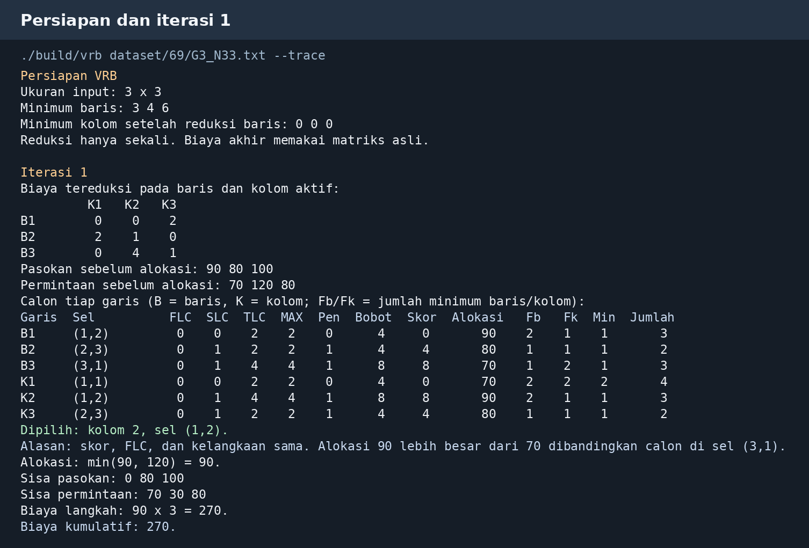
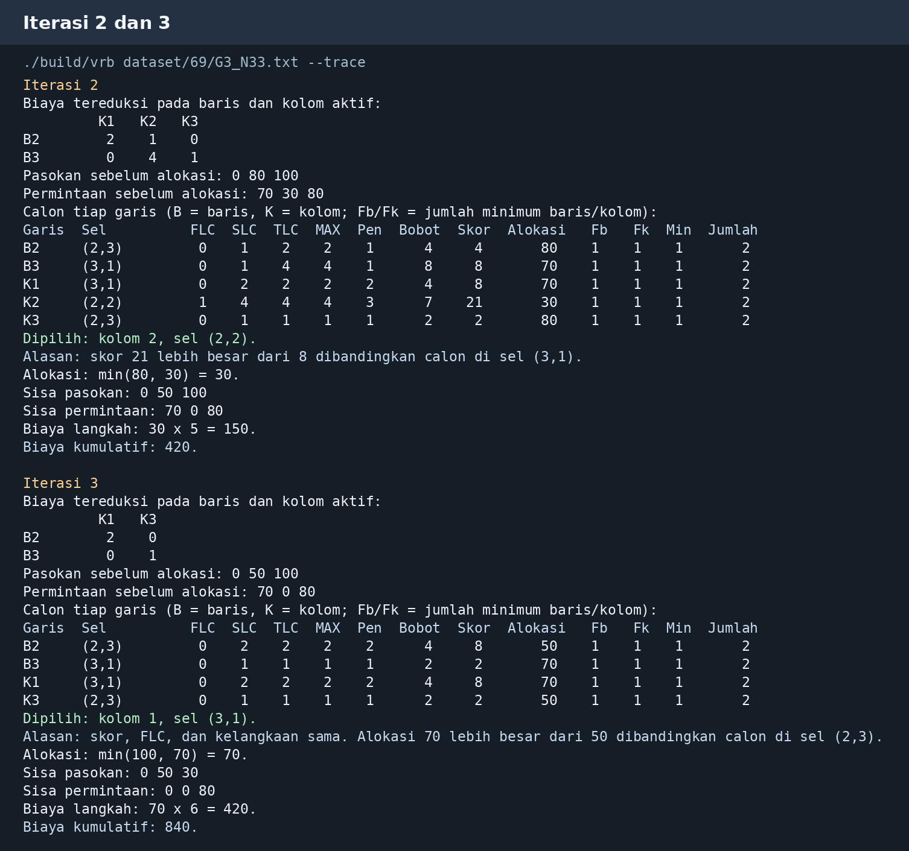
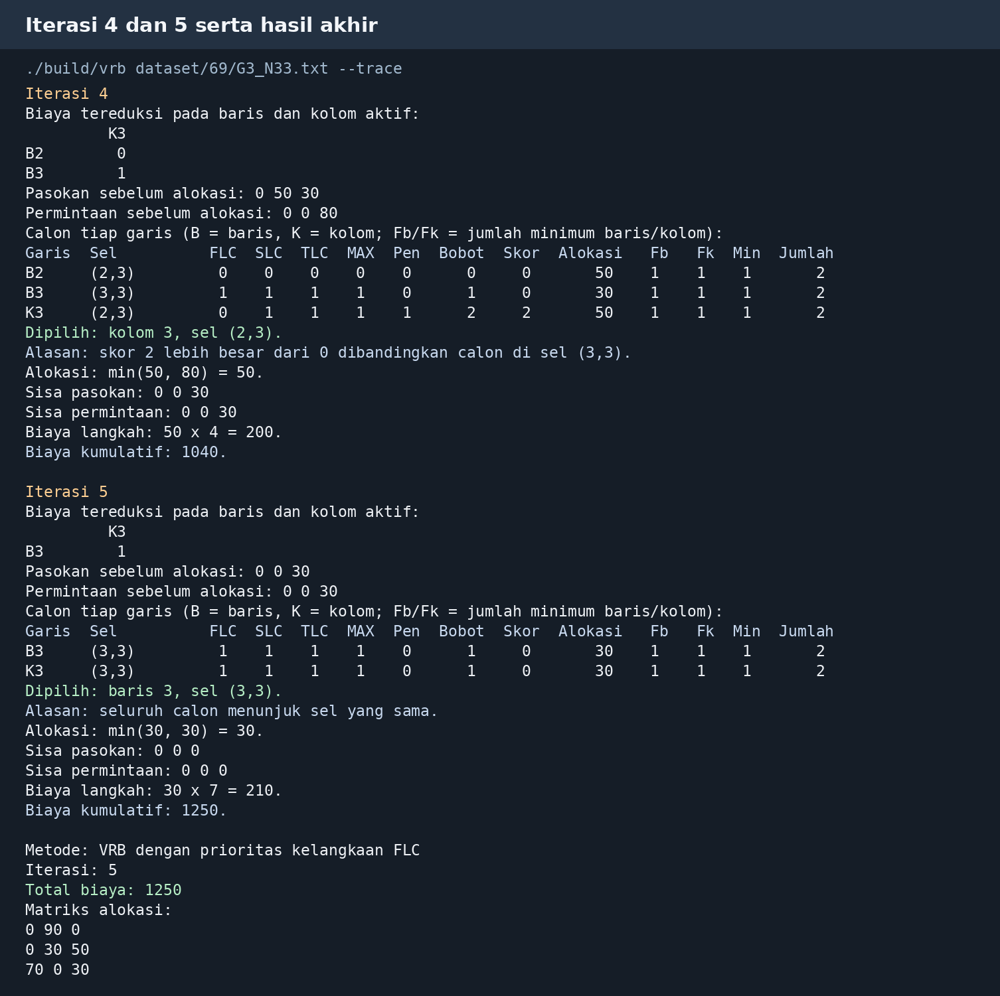

# VAM Reduksi Berbobot

Program C ini mencari solusi awal untuk masalah transportasi. Masukkan biaya pengiriman, pasokan, dan permintaan, lalu program menampilkan jumlah yang dikirim melalui setiap rute serta total biayanya. Opsi `--trace` menampilkan keputusan pada setiap iterasi.

## Menjalankan program

Kompilasi dengan `make` dan compiler C yang mendukung C11.

```sh
make
./build/vrb dataset/69/G3_N33.txt
./build/vrb dataset/69/G3_N33.txt --trace
```

Untuk mengetik data di terminal, jalankan `./build/vrb --cli --trace`, lalu masukkan angka berikut. Untuk masukan dari pipa, gunakan `--stdin`.

```text
3 3
3 3 5
6 5 4
6 10 7
90 80 100
70 120 80
```

Dua angka pertama adalah jumlah baris dan kolom. Tiga baris berikutnya adalah biaya per unit. Baris terakhir berisi permintaan, dan baris sebelumnya berisi pasokan. Format file sama dengan format terminal. Jika sebuah file dataset memiliki label optimum setelah permintaan, solver tidak membacanya. Untuk keluaran yang bisa dibaca program lain, tambahkan `--json`.

## Model transportasi dan IBFS

Misalkan ada $m$ sumber dan $n$ tujuan. Sebuah sel $(i,j)$ mewakili rute dari sumber $i$ ke tujuan $j$.

| Simbol | Arti |
|---|---|
| $c_{ij}$ | Biaya asli untuk mengirim satu unit pada sel $(i,j)$ |
| $x_{ij}$ | Jumlah yang dialokasikan pada sel $(i,j)$ |
| $s_i$, $d_j$ | Pasokan sumber $i$ dan permintaan tujuan $j$ pada awal masalah yang sudah seimbang |
| $s_i^{(t)}$, $d_j^{(t)}$ | Pasokan dan permintaan yang masih tersisa sebelum iterasi $t$ |
| $I_t$, $J_t$ | Himpunan baris dan kolom yang sisanya masih positif pada iterasi $t$ |

Tujuannya meminimalkan biaya total dengan memenuhi seluruh pasokan dan permintaan:

$$
\begin{aligned}
Z(X) &= \sum_{i=1}^{m}\sum_{j=1}^{n} c_{ij}x_{ij},\\
\sum_{j=1}^{n}x_{ij} &= s_i &&\text{untuk setiap sumber } i,\\
\sum_{i=1}^{m}x_{ij} &= d_j &&\text{untuk setiap tujuan } j,\\
x_{ij} &\ge 0 &&\text{untuk setiap sel } (i,j).
\end{aligned}
$$

Jika total pasokan melebihi permintaan, tambahkan kolom dummy dengan permintaan sebesar selisihnya. Jika permintaan lebih besar, tambahkan baris dummy dengan pasokan sebesar selisihnya. Kedua jenis dummy memakai biaya nol.

IBFS adalah *Initial Basic Feasible Solution*, atau solusi basis layak awal. Pada masalah transportasi seimbang, basis memiliki $m+n-1$ sel independen. Jika alokasi positifnya lebih sedikit, sebagian sel basis bernilai nol. Program menampilkan alokasi tanpa menandai sel basis nol untuk simpleks lanjutan.

## Cara kerja VAM

*Vogel's Approximation Method* (VAM) menghitung penalti dari biaya **asli**. Untuk suatu garis $\ell$, yaitu satu baris atau kolom aktif, urutkan biaya sel aktif dari yang terkecil. Jika $c_{\ell,(1)}$ dan $c_{\ell,(2)}$ adalah biaya pada dua posisi pertama, penaltinya adalah:

$$
P_\ell^{\mathrm{VAM}}=
\begin{cases}
c_{\ell,(2)}-c_{\ell,(1)}, & \text{jika ada minimal dua sel aktif},\\
c_{\ell,(1)}, & \text{jika hanya ada satu sel aktif pada kode pembanding}.
\end{cases}
$$

Selisih itu mengukur kenaikan biaya per unit jika pilihan termurah pada garis tersebut tidak bisa dipakai dan pilihan termurah kedua yang diambil. Biaya yang berulang tetap dihitung. Sebagai contoh, biaya $[3,3,5]$ memberi penalti $3-3=0$ karena ada dua pilihan seharga 3.

Pilih garis dengan penalti terbesar, lalu pilih sel berbiaya terkecil di garis itu. [Kode VAM pembanding](src/benchmark/methods/VAM.c) mempertahankan sel minimum pertama dan garis pertama yang ditemukan jika nilainya sama. Kode memeriksa baris dahulu, lalu kolom, masing-masing menurut urutan indeks. Alokasikan sebanyak mungkin ke sel terpilih:

$$
\begin{aligned}
q_{ij}&=\min\bigl(s_i^{(t)},d_j^{(t)}\bigr),\\
x_{ij}^{(t+1)}&=x_{ij}^{(t)}+q_{ij},\\
s_i^{(t+1)}&=s_i^{(t)}-q_{ij},\qquad
d_j^{(t+1)}=d_j^{(t)}-q_{ij}.
\end{aligned}
$$

Tutup baris atau kolom yang sisanya nol, lalu hitung ulang penalti pada sel yang masih aktif. VAM menyusun solusi awal dan tidak menjamin optimum. Lihat [penjelasan dan contoh VAM oleh Shore](https://onlinelibrary.wiley.com/doi/abs/10.1111/j.1540-5915.1970.tb00792.x).

**Dua iterasi pertama G3_N33.** Mulai dari biaya asli pada tabel input. Pada iterasi 1, semua baris dan kolom masih aktif.

| Garis | Biaya asli terurut | Penalti VAM |
|---|---|---:|
| Baris 1 | 3, 3, 5 | 0 |
| Baris 2 | 4, 5, 6 | 1 |
| Baris 3 | 6, 7, 10 | 1 |
| Kolom 1 | 3, 6, 6 | **3** |
| Kolom 2 | 3, 5, 10 | 2 |
| Kolom 3 | 4, 5, 7 | 1 |

Kolom 1 memiliki penalti terbesar, yaitu $6-3=3$. VAM memilih $(1,1)$ dan mengalokasikan $\min(90,70)=70$ unit dengan biaya $70\times3=210$. Setelah kolom 1 ditutup, biaya aktif baris 3 tinggal $[10,7]$. Penaltinya $10-7=3$, terbesar pada iterasi 2. VAM memilih $(3,3)$ dan mengalokasikan $\min(100,80)=80$ unit dengan biaya $80\times7=560$. Biaya kumulatifnya menjadi 770.

## Cara kerja VRB

VRB mengubah tiga bagian dari VAM: biaya yang dipakai untuk menilai calon, cara memberi bobot pada penalti, dan urutan pemilihan saat seri.

### Reduksi biaya satu kali

Setelah masalah seimbang, kurangi minimum masing-masing baris aktif dari biaya di baris itu. Dari hasil tersebut, kurangi minimum masing-masing kolom aktif. Untuk sel aktif awal:

$$
\begin{aligned}
r_i &= \min_{j\in J_1} c_{ij},\\
k_j &= \min_{i\in I_1}(c_{ij}-r_i),\\
c'_{ij} &= c_{ij}-r_i-k_j.
\end{aligned}
$$

$r_i$ adalah pengurang baris, $k_j$ pengurang kolom, dan $c'_{ij}$ biaya tereduksi. Garis yang sisanya nol sejak awal tidak ikut direduksi dan tidak menerima alokasi. Setelah suatu garis ditutup, VRB memperbarui statistik pada sel yang tersisa tanpa mereduksi ulang matriks. [Diagne dan Gningue](https://www.m-hikari.com/ams/ams-2011/ams-45-48-2011/sanghareAMS45-48-2011.pdf) juga memakai reduksi pada varian VAM mereka, dengan reduksi ulang setelah setiap alokasi.

Reduksi tidak mengubah urutan biaya solusi layak. Setiap solusi layak memiliki jumlah baris $s_i$ dan jumlah kolom $d_j$ yang sama, sehingga selisih biaya asli dan biaya tereduksi selalu konstanta berikut:

$$
Z(X)-\sum_{i=1}^{m}\sum_{j=1}^{n}c'_{ij}x_{ij}
=\sum_{i=1}^{m}r_i s_i+\sum_{j=1}^{n}k_j d_j.
$$

Reduksi tetap dapat mengubah pilihan VRB karena VRB membandingkan biaya **sel** untuk membentuk alokasi. Identitas ini tidak membuktikan bahwa keputusan VRB pasti optimal. Program menghitung biaya akhir dengan $c_{ij}$.

Pada G3_N33, minimum baris adalah $(3,4,6)$, dan minimum kolom setelah reduksi baris adalah $(0,0,0)$. Maka:

$$
C=
\begin{bmatrix}
3&3&5\\6&5&4\\6&10&7
\end{bmatrix}
\qquad
C'=
\begin{bmatrix}
0&0&2\\2&1&0\\0&4&1
\end{bmatrix}.
$$

Pada contoh ini, konstanta reduksi adalah $3(90)+4(80)+6(100)=1190$. Biaya tereduksi alokasi VRB adalah $30(1)+30(1)=60$, sehingga biaya asli menjadi $1190+60=1250$. Alokasi VAM memiliki biaya tereduksi 240 dan biaya asli $1190+240=1430$. Selisih biaya tetap 180 pada kedua matriks.

### Penalti, bobot, dan skor

| Simbol pada garis $\ell$ | Arti |
|---|---|
| $\mathrm{FLC}_\ell$ | Biaya tereduksi aktif terkecil |
| $\mathrm{SLC}_\ell$ | Biaya pada posisi kedua setelah diurutkan |
| $\mathrm{TLC}_\ell$ | Biaya pada posisi ketiga setelah diurutkan |
| $\mathrm{MAX}_\ell$ | Biaya tereduksi aktif terbesar |
| $P_\ell$, $B_\ell$, $S_\ell$ | Penalti, bobot, dan skor VRB |

Urutan biaya memasukkan nilai yang berulang. Jika hanya ada dua sel aktif, TLC disamakan dengan SLC. Jika tinggal satu sel, keempat statistik sama dengan biaya sel itu sehingga penaltinya dan skornya nol.

$$
\begin{aligned}
P_\ell &= \mathrm{SLC}_\ell-\mathrm{FLC}_\ell,\\
B_\ell &= \mathrm{MAX}_\ell+(\mathrm{TLC}_\ell-\mathrm{FLC}_\ell),\\
S_\ell &= P_\ell\,B_\ell.
\end{aligned}
$$

Penalti masih mengukur jarak dari pilihan termurah ke pilihan berikutnya. Bobot menambah pengaruh biaya terbesar dan jarak ke biaya ketiga. Pada kolom 2 di iterasi pertama G3_N33, biaya tereduksi terurut adalah $[0,1,4]$. Penalti $1-0=1$, bobot $4+(4-0)=8$, dan skor $1\times8=8$. Baris 3 mendapat skor 8 juga. Pada iterasi 2, kolom 2 tinggal punya biaya $[1,4]$. TLC menjadi 4 dan skornya $(4-1)\bigl(4+(4-1)\bigr)=21$.

### Memilih sel dan menyelesaikan seri

**Dalam satu garis**, pilih sel dengan biaya FLC. Jika ada beberapa sel dengan biaya itu, ambil $q_{ij}$ terbesar. Jika masih sama, ambil indeks pasangan terkecil, yaitu indeks kolom untuk calon dari baris atau indeks baris untuk calon dari kolom. Sebagai contoh, baris 1 G3_N33 mempunyai dua biaya nol pada kolom 1 dan 2. Kapasitas masing-masing adalah $\min(90,70)=70$ dan $\min(90,120)=90$, sehingga calon baris 1 adalah $(1,2)$.

**Antar garis**, periksa jumlah pilihan minimum pada baris dan kolom dari sel calon. Setiap hitungan memakai minimum garisnya sendiri.

$$
\begin{aligned}
N_i^{\mathrm{baris}}
&=\#\bigl\{k\in J_t : c'_{ik}=\min_{j\in J_t}c'_{ij}\bigr\},\\
N_j^{\mathrm{kolom}}
&=\#\bigl\{k\in I_t : c'_{kj}=\min_{i\in I_t}c'_{ij}\bigr\},\\
K_{ij}^{\min}&=\min\bigl(N_i^{\mathrm{baris}},N_j^{\mathrm{kolom}}\bigr),\\
K_{ij}^{\mathrm{jumlah}}&=N_i^{\mathrm{baris}}+N_j^{\mathrm{kolom}}.
\end{aligned}
$$

Pada keluaran JSON, $N_i^{\mathrm{baris}}$ dan $N_j^{\mathrm{kolom}}$ diberi nama `FLC_ROW_COUNT` dan `FLC_COLUMN_COUNT`. Pada tabel jejak, keduanya tampil sebagai **Fb** dan **Fk**, lalu $K_{ij}^{\min}$ dan $K_{ij}^{\mathrm{jumlah}}$ tampil sebagai **Min** dan **Jumlah**. Misalnya, pada iterasi 2 G3_N33, kolom 2 mengusulkan sel $(2,2)$ dengan biaya tereduksi 1. Minimum baris 2 justru 0 pada sel $(2,3)$, sehingga Fb menghitung sel berbiaya 0 pada baris itu. Hitungan ini memberi prioritas pada calon dengan lebih sedikit alternatif di biaya minimum. Bandingkan kriteria berikut satu per satu sampai ada yang berbeda:

1. SKOR terbesar.
2. FLC calon terkecil.
3. $K_{ij}^{\min}$ terkecil.
4. $K_{ij}^{\mathrm{jumlah}}$ terkecil.
5. $q_{ij}$ terbesar.
6. Indeks baris terkecil, kemudian indeks kolom terkecil.

Jika calon baris dan kolom mengacu pada sel yang sama dan tetap seri, kode memilih label baris lebih dahulu. Alokasi dan biaya selnya tetap sama.

| Calon pada iterasi 1 G3_N33 | Sel | SKOR | FLC | Fb | Fk | Min | Jumlah | Alokasi |
|---|---|---:|---:|---:|---:|---:|---:|---:|
| Baris 3 | (3,1) | 8 | 0 | 1 | 2 | 1 | 3 | 70 |
| Kolom 2 | (1,2) | 8 | 0 | 2 | 1 | 1 | 3 | 90 |

Pada $(3,1)$, baris 3 mempunyai satu nol dan kolom 1 mempunyai dua nol. Jadi nilai min adalah $\min(1,2)=1$, dan jumlahnya $1+2=3$. Pada $(1,2)$, hasilnya juga 1 dan 3. Kelangkaannya seri, sehingga alokasi 90 menang atas 70. Kode menutup baris 1 dan menyisakan 30 unit permintaan di kolom 2.

**Saat kelangkaan menentukan pilihan.** Pada ilustrasi di luar benchmark, gunakan baris biaya $[0,1,1]$, $[1,0,1]$, $[0,1,0]$ dengan pasokan dan permintaan $(8,4,6)$. Semua minimum baris dan kolom bernilai nol, jadi matriks tetap sama setelah reduksi. Berikut sel calon dari garis yang seri pada skor tertinggi 2 dan FLC 0.

| Sel calon | Fb | Fk | Min | Jumlah | Alokasi |
|---|---:|---:|---:|---:|---:|
| (1,1) | 1 | 2 | 1 | 3 | 8 |
| (2,2) | 1 | 1 | 1 | **2** | 4 |
| (3,3) | 2 | 1 | 1 | 3 | 6 |

VRB memilih $(2,2)$ karena jumlah hitungan minimumnya paling kecil. Alokasi yang lebih besar pada calon lain baru diperiksa jika jumlah ini masih seri. Jika skor suatu garis positif, SLC lebih besar dari FLC, sehingga garis pengusul hanya mempunyai satu sel minimum dan $K_{ij}^{\min}=1$. Pada seri skor positif, hitungan jumlah masih dapat membedakan calon, seperti pada tabel ini.

### Alokasi dan biaya akhir

VRB mengalokasikan $q_{ij}$ pada sel terpilih dan mengurangi sisa pasokan serta permintaan seperti pada VAM. Biaya setiap langkah dihitung dengan biaya asli, yaitu $q_{ij}c_{ij}$. Pada G3_N33:

$$
Z_{\mathrm{VRB}}
=90\times3+30\times5+70\times6+50\times4+30\times7
=1250.
$$

Setelah semua garis selesai, program memeriksa bahwa alokasi nonnegatif, jumlah tiap baris dan kolom tepat, dan total biaya cocok dengan matriks alokasi. [Inti VRB](src/vrb/vrb.c) mengerjakan semua perhitungan. Parser membaca input dan modul pelacakan menampilkan langkah yang dikirim inti. Mengaktifkan jejak tidak mengubah keputusan. Untuk menghindari pengurutan ulang, inti mengurutkan sel aktif sekali per garis. Saat baris atau kolom habis, sel pada garis itu dikeluarkan dari daftar yang berpotongan. Inti membaca FLC, SLC, dan TLC dari awal daftar, MAX dari akhirnya, dan memperbarui jumlah minimum bila sel yang hilang mengubah hitungan.

## Flowchart VRB

Diagram pertama menunjukkan alur dari membaca input sampai validasi biaya akhir. Diagram kedua merinci cara memilih calon dalam satu garis dan cara menyelesaikan seri antar garis.


## Contoh G3_N33 dari dataset 69

VRB mencapai biaya optimum **1.250**, sedangkan VAM menghasilkan **1.430**. Penghematan terhadap biaya VAM adalah `(1.430 - 1.250) / 1.430 × 100% = 12,59%`. Gap VAM terhadap optimum adalah `180 / 1.250 × 100% = 14,40%`.

Pada iterasi pertama VRB, baris 3 dan kolom 2 sama-sama memiliki SKOR 8, FLC 0, minimum hitungan FLC 1, dan total hitungan 3. Alokasi 90 pada sel `(1, 2)` mengalahkan 70 pada sel `(3, 1)`. VAM memilih `(1, 1)` karena penalti kolom 1 paling besar pada biaya asli. Pada iterasi ketiga, VAM kemudian mengirim 20 unit melalui sel `(3, 2)` dengan biaya 10 per unit. VRB menghindari rute tersebut. Pada contoh ini, hitungan kelangkaan tidak memutus seri, sehingga hasilnya menunjukkan perbedaan antara VRB dan VAM sebagai metode lengkap.

| Iterasi | Sel VRB | Unit VRB | Biaya tahap VRB | Sel VAM | Unit VAM | Biaya tahap VAM |
|---:|:---:|---:|---:|:---:|---:|---:|
| 1 | (1, 2) | 90 | 270 | (1, 1) | 70 | 210 |
| 2 | (2, 2) | 30 | 150 | (3, 3) | 80 | 560 |
| 3 | (3, 1) | 70 | 420 | (3, 2) | 20 | 200 |
| 4 | (2, 3) | 50 | 200 | (2, 2) | 80 | 400 |
| 5 | (3, 3) | 30 | 210 | (1, 2) | 20 | 60 |
| **Total** | | **270** | **1.250** | | **270** | **1.430** |

Gambar berikut dibuat dari keluaran asli `--trace`. Tabel pada gambar menunjukkan calon tiap garis, alasan pemilihan, sisa pasokan dan permintaan, serta biaya kumulatif.







## Pengujian dataset 69

Pembanding memakai kode yang tersedia pada proyek. NWCM mengikuti urutan sel dari sudut kiri atas, LCM memilih biaya langsung terkecil, dan [Cost Supply Method](https://etasr.com/index.php/ETASR/article/view/16468) menggabungkan biaya dengan pasokan. SAM dan RBSM menyesuaikan alokasi ketika pasokan suatu baris belum sesuai. Fractional memakai rasio dua biaya minimum sebagai penalti. Pembanding lain pada tabel memakai skor atau aturan alokasi masing-masing. Varian SAM terkoreksi, LCM2 koreksi batas, dan CSM2 int64 ditampilkan terpisah dari kode aslinya.

### Lima pembanding dengan gap terendah

Kedua grafik memakai kelompok yang sama. Lima pembanding dipilih berdasarkan gap rata-rata terendah di antara metode yang menghasilkan alokasi layak pada seluruh 69 kasus: VRB lama, TOCM-TDM1, SAM terkoreksi, RBSM, dan VAM. VRB tie-break menjadi acuan. Urutan ini memakai gap rata-rata karena jumlah optimum tidak menunjukkan besar selisih biaya pada kasus yang belum optimal.


VRB tie-break dan VRB lama sama-sama mencapai 55 solusi optimal dari 69 kasus. SAM terkoreksi lebih sering mencapai optimum daripada TOCM-TDM1, meskipun gap rata-ratanya sedikit lebih besar. Kedua ukuran itu menjawab pertanyaan yang berbeda.


Median runtime VRB tie-break adalah 0,8298 ms per kasus, lebih tinggi daripada kelima pembanding pada grafik. Runtime diukur dari program mulai sampai selesai, termasuk membaca input dan menyiapkan keluaran. Tabel di bawah tetap menampilkan semua metode, termasuk CSM dan Fractional.

### Kualitas solusi

Untuk biaya solusi $Z$ dan biaya optimum $Z^\star$, gap per kasus adalah:

$$
\mathrm{Gap}(\%)=100\,\frac{Z-Z^\star}{Z^\star}.
$$

Rata-rata gap memakai kasus layak dengan optimum positif. Kolom **Optimal** menghitung hasil layak yang biayanya sama dengan optimum tersertifikasi. M/S/K berarti menang, seri, dan kalah dari sudut pandang VRB. Biaya yang lebih rendah berarti menang. Kasus dengan salah satu hasil tidak layak dikeluarkan dari perbandingan, sehingga jumlah pasangan bisa kurang dari 69.

| Metode | Layak | Gap rata-rata (%) | Optimal | M/S/K VRB | Pasangan |
|---|---:|---:|---:|---:|---:|
| VRB tie-break | 69/69 | 0,789262 | 55 | - | - |
| VRB lama | 69/69 | 0,789262 | 55 | 0/69/0 | 69 |
| VAM | 69/69 | 3,565986 | 36 | 26/38/5 | 69 |
| SAM asli | 67/69 | 1,792396 | 48 | 14/51/2 | 67 |
| SAM terkoreksi | 69/69 | 2,115392 | 48 | 16/51/2 | 69 |
| RBSM | 69/69 | 2,473487 | 45 | 24/41/4 | 69 |
| CSM | 69/69 | 3,783236 | 42 | 26/39/4 | 69 |
| Fractional | 69/69 | 3,983091 | 28 | 36/30/3 | 69 |
| NWCM_FIX | 69/69 | 44,041184 | 3 | 66/3/0 | 69 |
| LCM2 | 69/69 | 6,795846 | 14 | 51/16/2 | 69 |
| LCM2 koreksi batas | 69/69 | 6,795846 | 14 | 51/16/2 | 69 |
| CSM2 asli | 69/69 | 3,789324 | 43 | 26/39/4 | 69 |
| CSM2 int64 | 69/69 | 3,789324 | 43 | 26/39/4 | 69 |
| RCWMCAM | 69/69 | 7,039858 | 21 | 46/23/0 | 69 |
| IHW | 69/69 | 4,441102 | 40 | 26/34/9 | 69 |
| EXP-ICHW | 69/69 | 4,398083 | 34 | 31/37/1 | 69 |
| TOCM-TDM1 | 69/69 | 2,112915 | 42 | 24/38/7 | 69 |
| BCE | 62/69 | 2,705478 | 41 | 19/39/4 | 62 |
| PowerRank | 69/69 | 3,780388 | 30 | 33/33/3 | 69 |
| JHM_langsung | 67/69 | 2,916807 | 40 | 23/40/4 | 67 |

VRB dan VRB lama sama pada seluruh 69 kasus. Keduanya mencapai 55 optimum dengan gap rata-rata 0,789262%. Terhadap VAM, VRB menang pada 26 kasus, seri pada 38, dan kalah pada 5. SAM asli, BCE, dan JHM memiliki hasil tidak layak pada sebagian kasus. Gap rata-rata ketiganya memakai jumlah kasus yang berbeda.

### Runtime program lengkap

Setiap kasus dijalankan satu kali untuk pemanasan dan validasi, lalu tiga kali untuk pengukuran. Ambil median tiga pengulangan untuk tiap kasus. Tabel berikut merangkum median, rata-rata, minimum, dan maksimum dari median kasus yang layak. M/S/K runtime juga dari sudut pandang VRB. Waktu lebih singkat berarti menang. Seri berarti median dalam nanodetik persis sama.

| Metode | Median (ms) | Rata-rata (ms) | Min (ms) | Maks (ms) | M/S/K VRB | Pasangan |
|---|---:|---:|---:|---:|---:|---:|
| VRB tie-break | 0,8298 | 0,8438 | 0,7668 | 1,0787 | - | - |
| VRB lama | 0,6816 | 0,7156 | 0,6412 | 1,0973 | 2/0/67 | 69 |
| VAM | 0,5899 | 0,6130 | 0,5572 | 0,9968 | 0/0/69 | 69 |
| SAM asli | 0,5866 | 0,5959 | 0,5451 | 0,8263 | 0/0/67 | 67 |
| SAM terkoreksi | 0,5883 | 0,6010 | 0,5523 | 0,7452 | 0/0/69 | 69 |
| RBSM | 0,6056 | 0,6183 | 0,5622 | 0,8477 | 0/0/69 | 69 |
| CSM | 0,5967 | 0,6147 | 0,5582 | 0,9012 | 0/0/69 | 69 |
| Fractional | 0,9252 | 0,9495 | 0,8364 | 1,2689 | 64/0/5 | 69 |
| NWCM_FIX | 0,5932 | 0,6029 | 0,5500 | 0,8217 | 0/0/69 | 69 |
| LCM2 | 0,6390 | 0,6530 | 0,6020 | 0,9864 | 2/0/67 | 69 |
| LCM2 koreksi batas | 0,6419 | 0,6551 | 0,5947 | 0,8191 | 0/0/69 | 69 |
| CSM2 asli | 0,5927 | 0,6050 | 0,5571 | 0,7702 | 0/0/69 | 69 |
| CSM2 int64 | 0,5927 | 0,6083 | 0,5558 | 0,8422 | 0/0/69 | 69 |
| RCWMCAM | 0,6743 | 0,7011 | 0,6291 | 1,0138 | 0/0/69 | 69 |
| IHW | 0,7822 | 0,8039 | 0,7243 | 1,1663 | 11/0/58 | 69 |
| EXP-ICHW | 0,6934 | 0,7153 | 0,6421 | 1,0131 | 1/0/68 | 69 |
| TOCM-TDM1 | 0,5970 | 0,6085 | 0,5571 | 0,7754 | 0/0/69 | 69 |
| BCE | 0,5910 | 0,5981 | 0,5385 | 0,7667 | 0/0/62 | 62 |
| PowerRank | 0,6064 | 0,6359 | 0,5619 | 0,9267 | 0/0/69 | 69 |
| JHM_langsung | 0,5950 | 0,6064 | 0,5577 | 0,7565 | 0/0/67 | 67 |

Pengukuran memakai AMD Ryzen 7 8845HS, satu CPU, dan kompilasi `-O2`. Waktu mencakup proses mulai, membaca input, menghitung alokasi, menyiapkan keluaran, dan proses selesai. Format keluaran setiap implementasi dapat berbeda. Angka ini mengukur program lengkap pada lingkungan pengujian. VRB lebih cepat daripada Fractional pada 64 dari 69 kasus dan lebih lambat daripada VAM pada seluruh 69 kasus.

Untuk mengulang benchmark dengan Python 3, GCC, G++, dan `make`, jalankan:

```sh
python3 src/benchmark/run.py --output results/69-ulangan
```

[Data per kasus](results/69/cases.csv) dan [protokol pengukuran](results/69/protocol.json) mendukung tabel di atas. Hasil dataset lain tersedia di [results](results).
