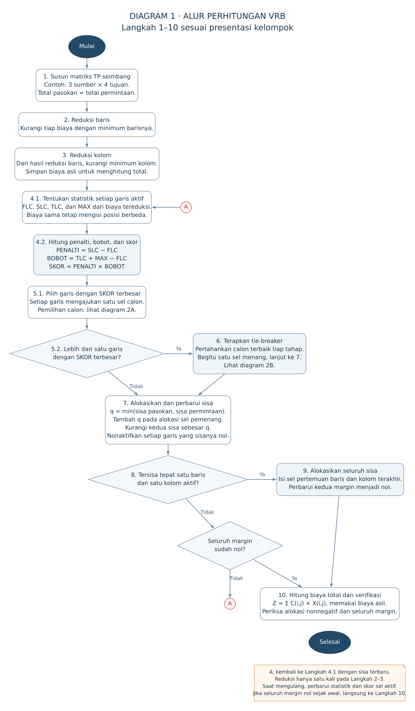
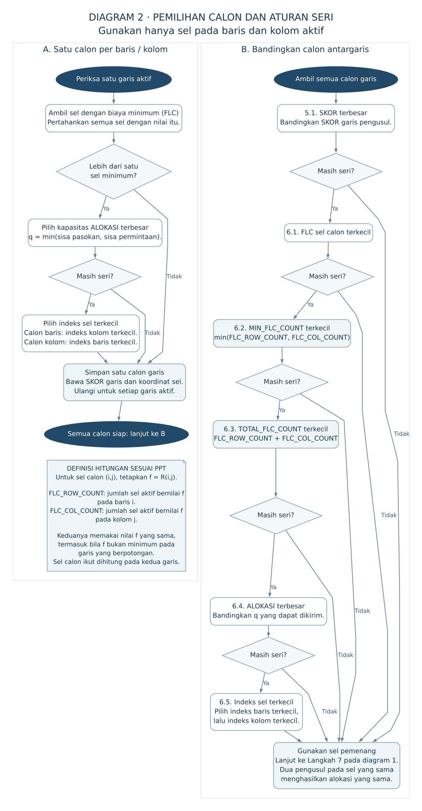
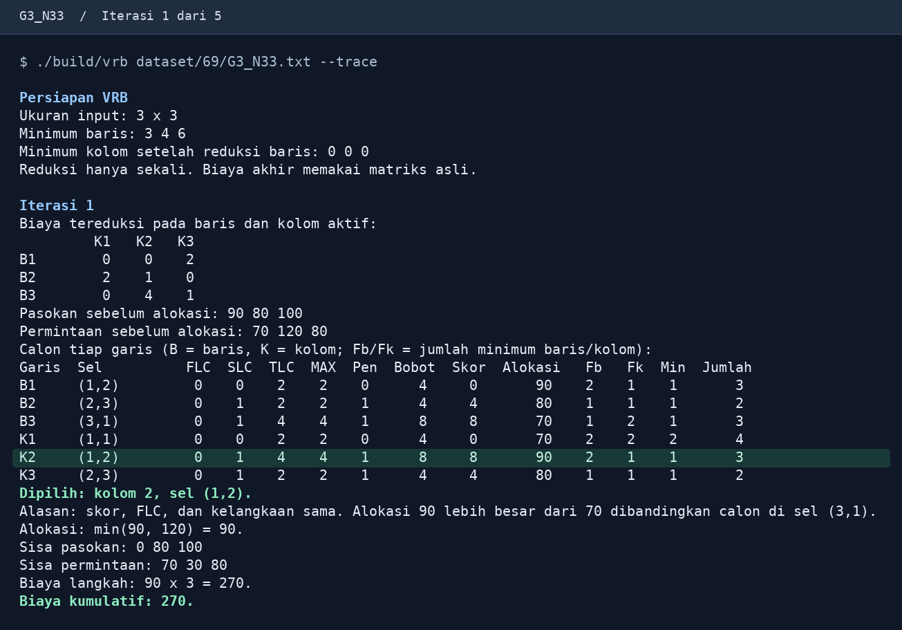
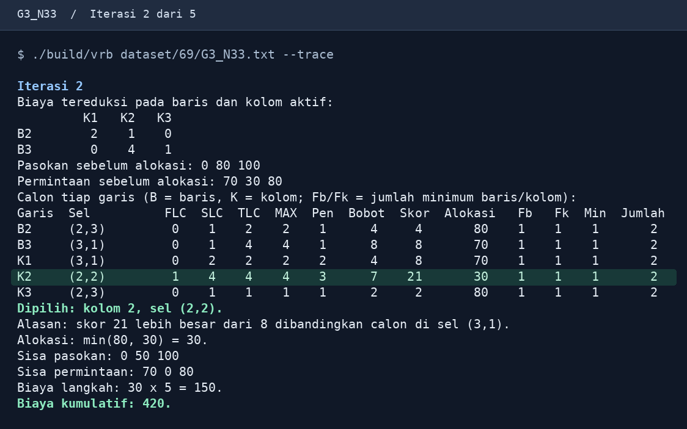
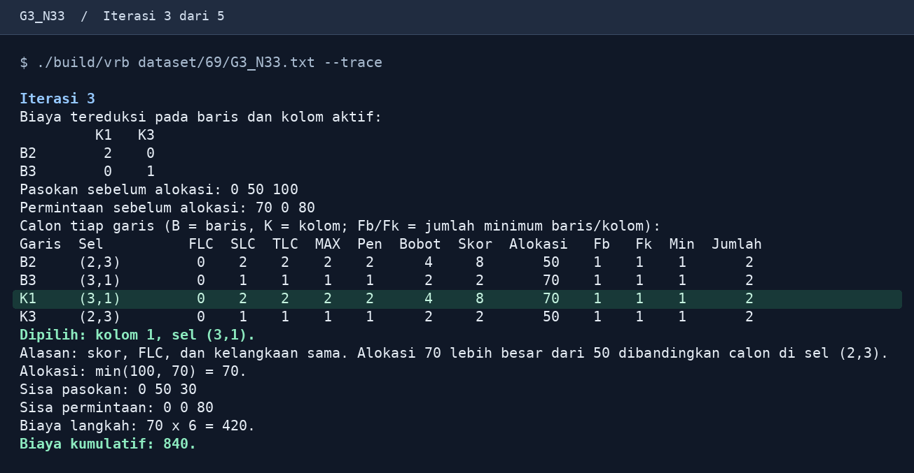
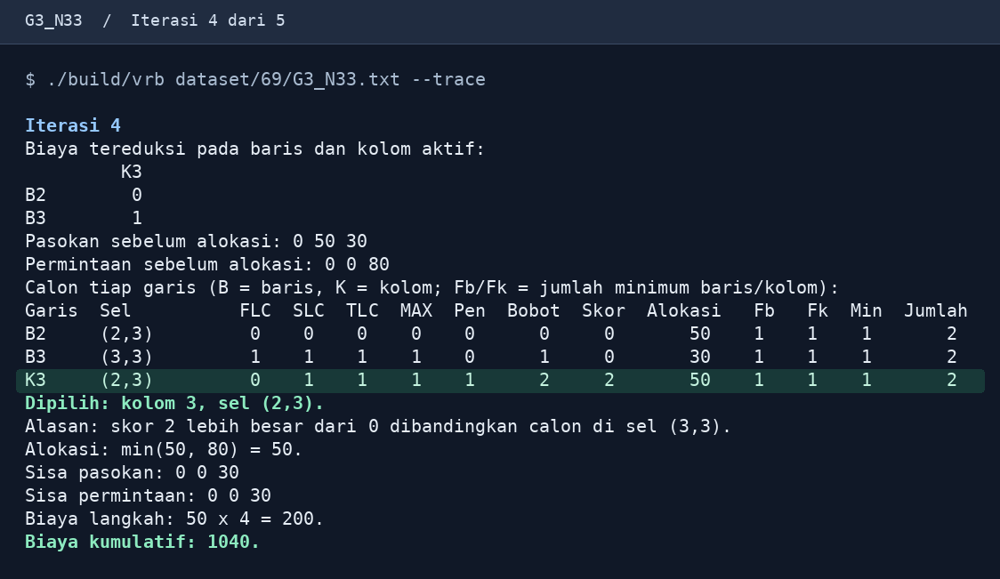
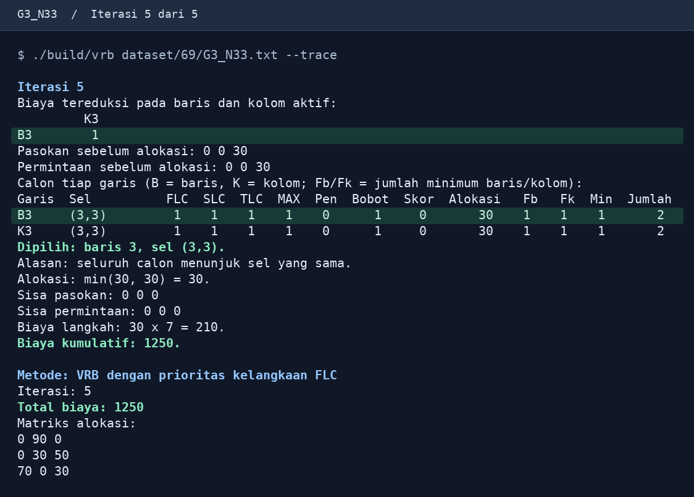
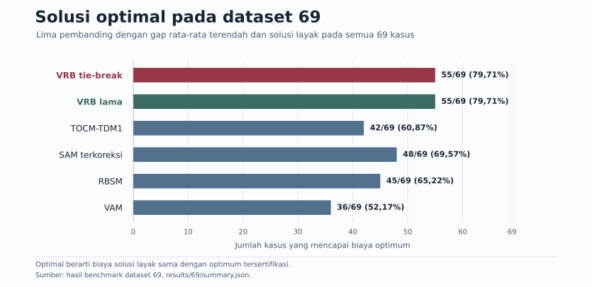
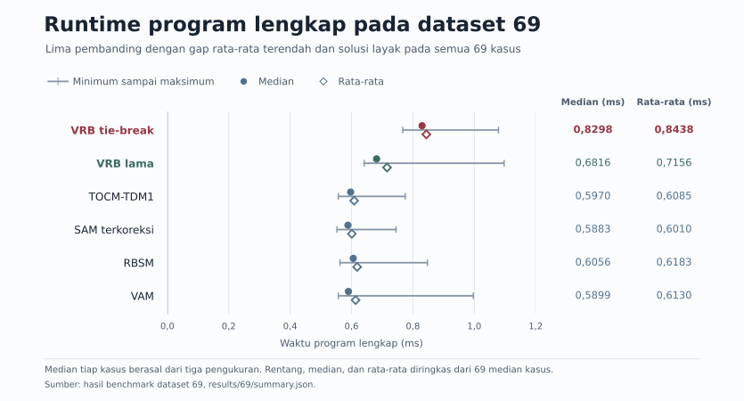

# VAM Reduksi Berbobot

Program C ini mencari solusi awal untuk masalah transportasi. Masukkan biaya pengiriman, pasokan, dan permintaan, lalu program menampilkan jumlah yang dikirim melalui setiap rute serta total biayanya. Opsi `--trace` menampilkan keputusan pada setiap iterasi.

## Menjalankan program

Kompilasi program dengan GCC atau Clang dalam mode C11.

```sh
mkdir -p build
cc -std=c11 -O2 -Isrc/vrb -Isrc/helper \
  src/vrb/main.c src/vrb/vrb.c src/helper/input.c src/helper/trace.c \
  -o build/vrb
./build/vrb dataset/69/G3_N33.txt
./build/vrb dataset/69/G3_N33.txt --trace
```

Untuk mengetik data di terminal, jalankan `./build/vrb --cli --trace`, lalu masukkan angka berikut. Untuk masukan dari pipa, gunakan `--stdin`.

```text
3 3
3 3 5
6 5 4
6 10 7
90 80 100
70 120 80
```

Dua angka pertama adalah jumlah baris dan kolom. Tiga baris berikutnya adalah biaya per unit. Baris terakhir berisi permintaan, dan baris sebelumnya berisi pasokan. Format file sama dengan format terminal. Jika sebuah file dataset memiliki label optimum setelah permintaan, solver tidak membacanya. Untuk keluaran yang bisa dibaca program lain, tambahkan `--json`.

## Model transportasi dan IBFS

Misalkan ada $m$ sumber dan $n$ tujuan. Sebuah sel $(i,j)$ mewakili rute dari sumber $i$ ke tujuan $j$.

| Simbol | Arti |
|---|---|
| $C(i,j)$ | Biaya asli untuk mengirim satu unit pada sel $(i,j)$ |
| $X(i,j)$ | Jumlah yang dialokasikan pada sel $(i,j)$ |
| $s_i$, $d_j$ | Pasokan sumber $i$ dan permintaan tujuan $j$ pada awal masalah yang sudah seimbang |
| $s_i^{(t)}$, $d_j^{(t)}$ | Pasokan dan permintaan yang masih tersisa sebelum iterasi $t$ |
| $I_t$, $J_t$ | Himpunan baris dan kolom yang sisanya masih positif pada iterasi $t$ |

Tujuannya meminimalkan biaya total dengan memenuhi seluruh pasokan dan permintaan:

```math
\begin{aligned}
Z(X) &= \sum_{i=1}^{m}\sum_{j=1}^{n} C(i,j)X(i,j),\\
\sum_{j=1}^{n}X(i,j) &= s_i &&\text{untuk setiap sumber } i,\\
\sum_{i=1}^{m}X(i,j) &= d_j &&\text{untuk setiap tujuan } j,\\
X(i,j) &\ge 0 &&\text{untuk setiap sel } (i,j).
\end{aligned}
```

Jika total pasokan melebihi permintaan, tambahkan kolom dummy dengan permintaan sebesar selisihnya. Jika permintaan lebih besar, tambahkan baris dummy dengan pasokan sebesar selisihnya. Kedua jenis dummy memakai biaya nol.

IBFS adalah *Initial Basic Feasible Solution*, atau solusi basis layak awal. Pada masalah transportasi seimbang, basis memiliki $m+n-1$ sel independen. Jika alokasi positifnya lebih sedikit, sebagian sel basis bernilai nol. Program menampilkan alokasi tanpa menandai sel basis nol untuk simpleks lanjutan.

## Cara kerja VAM

*Vogel's Approximation Method* (VAM) menghitung penalti dari biaya **asli**. Untuk suatu garis $\ell$, yaitu satu baris atau kolom aktif, urutkan biaya sel aktif dari yang terkecil. Jika $c_{\ell,(1)}$ dan $c_{\ell,(2)}$ adalah biaya pada dua posisi pertama, penaltinya adalah:

```math
P_\ell^{\mathrm{VAM}}=
\begin{cases}
c_{\ell,(2)}-c_{\ell,(1)}, & \text{jika ada minimal dua sel aktif},\\
c_{\ell,(1)}, & \text{jika hanya ada satu sel aktif pada kode pembanding}.
\end{cases}
```

Selisih itu mengukur kenaikan biaya per unit jika pilihan termurah pada garis tersebut tidak bisa dipakai dan pilihan termurah kedua yang diambil. Biaya yang berulang tetap dihitung. Sebagai contoh, biaya $[3,3,5]$ memberi penalti $3-3=0$ karena ada dua pilihan seharga 3.

Pilih garis dengan penalti terbesar, lalu pilih sel berbiaya terkecil di garis itu. [Kode VAM pembanding](src/benchmark/methods/VAM.c) mempertahankan sel minimum pertama dan garis pertama yang ditemukan jika nilainya sama. Kode memeriksa baris dahulu, lalu kolom, masing-masing menurut urutan indeks. Alokasikan sebanyak mungkin ke sel terpilih:

```math
\begin{aligned}
q_{ij}&=\min\bigl(s_i^{(t)},d_j^{(t)}\bigr),\\
X^{(t+1)}(i,j)&=X^{(t)}(i,j)+q_{ij},\\
s_i^{(t+1)}&=s_i^{(t)}-q_{ij},\qquad
d_j^{(t+1)}=d_j^{(t)}-q_{ij}.
\end{aligned}
```

Tutup baris atau kolom yang sisanya nol, lalu hitung ulang penalti pada sel yang masih aktif. VAM menyusun solusi awal dan tidak menjamin optimum. Lihat [penjelasan dan contoh VAM oleh Shore](https://onlinelibrary.wiley.com/doi/abs/10.1111/j.1540-5915.1970.tb00792.x).

**Dua iterasi pertama G3_N33.** Mulai dari biaya asli pada tabel input. Pada iterasi 1, semua baris dan kolom masih aktif.

| Garis | Biaya asli terurut | Penalti VAM |
|---|---|---:|
| Baris 1 | 3, 3, 5 | 0 |
| Baris 2 | 4, 5, 6 | 1 |
| Baris 3 | 6, 7, 10 | 1 |
| Kolom 1 | 3, 6, 6 | **3** |
| Kolom 2 | 3, 5, 10 | 2 |
| Kolom 3 | 4, 5, 7 | 1 |

Kolom 1 memiliki penalti terbesar, yaitu $6-3=3$. VAM memilih $(1,1)$ dan mengalokasikan $\min(90,70)=70$ unit dengan biaya $70\times3=210$. Setelah kolom 1 ditutup, biaya aktif baris 3 tinggal $[10,7]$. Penaltinya $10-7=3$, terbesar pada iterasi 2. VAM memilih $(3,3)$ dan mengalokasikan $\min(100,80)=80$ unit dengan biaya $80\times7=560$. Biaya kumulatifnya menjadi 770.

## Langkah informal VRB

1. **Siapkan tabel transportasi.** Isi biaya asli $C(i,j)$, pasokan tiap baris, dan permintaan tiap kolom. Jika pasokan lebih besar, tambah kolom dummy. Jika permintaan lebih besar, tambah baris dummy. Isi margin dummy sebesar selisih kedua total dan beri biaya nol pada sel dummy.
2. **Reduksi biaya sekali di awal.**
   - Kurangi biaya setiap sel aktif dengan biaya terkecil pada barisnya.
   - Dari hasil tersebut, kurangi lagi dengan biaya terkecil pada kolomnya. Hasilnya adalah biaya tereduksi $C'(i,j)$.
3. **Hitung skor setiap baris dan kolom yang masih aktif.**
   - Baca biaya tereduksi dari yang terkecil. Ambil biaya pertama (**FLC**), kedua (**SLC**), ketiga (**TLC**), dan terbesar (**MAX**). Biaya yang sama tetap dihitung pada posisi terpisah.
   - Jika ada dua sel aktif, samakan TLC dengan SLC. Jika tinggal satu sel, samakan keempat nilai dengan biaya sel tersebut.
   - Hitung **PENALTI** = SLC − FLC, **BOBOT** = MAX + (TLC − FLC), dan **SKOR** = PENALTI × BOBOT.
4. **Ambil satu calon dari tiap baris dan kolom aktif.** Pilih sel berbiaya FLC pada baris atau kolom tersebut. Jika ada beberapa, pilih yang bisa menerima unit terbanyak. Jumlah itu adalah nilai terkecil antara sisa pasokan dan sisa permintaan. Jika masih seri, pilih indeks kolom terkecil untuk calon dari baris atau indeks baris terkecil untuk calon dari kolom.
5. **Pilih calon dengan skor terbesar.** Jika skor seri, bandingkan kriteria di bawah satu per satu. **Fb** dan **Fk** adalah jumlah sel aktif yang mencapai biaya minimum pada baris dan kolom sel calon, masing-masing berdasarkan minimum garisnya sendiri.
   1. FLC pada garis pengusul paling kecil.
   2. Nilai **Min** paling kecil, yaitu nilai terkecil antara Fb dan Fk.
   3. Nilai **Jumlah** paling kecil, yaitu Fb + Fk.
   4. Jumlah unit yang dapat dialokasikan paling besar.
   5. Indeks baris sel paling kecil, kemudian indeks kolom sel paling kecil.
   6. Jika keduanya mengusulkan sel yang sama dan semua kriteria seri, pilih label pengusul baris.
6. **Alokasikan unit dan perbarui tabel.** Kurangi sisa pasokan dan permintaan sesuai jumlah yang dikirim. Tutup setiap baris atau kolom yang sisanya nol. Jika masih ada pasokan, ulangi dari langkah 3 dengan biaya tereduksi dan sel yang masih aktif. Jika seluruh margin sudah nol, lanjut ke langkah 7.
7. **Hitung biaya akhir.** Kalikan alokasi pada setiap sel dengan biaya asli $C(i,j)$, lalu jumlahkan. Periksa bahwa total alokasi tiap baris dan kolom memenuhi pasokan dan permintaannya.

## Langkah formal VRB

VRB mereduksi biaya sekali, memberi bobot pada penalti, dan memakai jumlah pilihan minimum untuk membandingkan calon yang seri. Notasi $C(i,j)$ menyatakan biaya asli per unit dari sumber $i$ ke tujuan $j$, sedangkan $C'(i,j)$ menyatakan biaya setelah reduksi.

### Langkah 1. Susun dan seimbangkan tabel transportasi

Susun matriks $C$ berukuran $m\times n$, vektor pasokan $s_i$, dan vektor permintaan $d_j$. Hitung total pasokan $S=\sum_i s_i$ dan total permintaan $D=\sum_j d_j$.

- Jika $S>D$, tambahkan kolom dummy dengan permintaan $S-D$.
- Jika $D>S$, tambahkan baris dummy dengan pasokan $D-S$.
- Jika $S=D$, gunakan tabel yang sudah seimbang.

Tetapkan $C(i,j)=0$ untuk seluruh sel dummy. Gunakan ukuran tabel setelah penyeimbangan untuk $m$ dan $n$ pada langkah berikutnya. Mulai dengan $X^{(1)}(i,j)=0$ untuk setiap sel, $s_i^{(1)}=s_i$, dan $d_j^{(1)}=d_j$. Jika total pasokan setelah penyeimbangan nol, langsung ke Langkah 9.

### Langkah 2. Reduksi biaya satu kali

Baris aktif adalah baris dengan sisa pasokan positif. Kolom aktif adalah kolom dengan sisa permintaan positif. Pada awal proses, himpunan keduanya adalah $`I_1=\{i:s_i>0\}`$ dan $`J_1=\{j:d_j>0\}`$. Hitung minimum baris $r_i$, lalu minimum kolom $k_j$ dari biaya yang sudah dikurangi minimum baris.

```math
\begin{aligned}
r_i &= \min_{j\in J_1} C(i,j), && i\in I_1,\\
k_j &= \min_{i\in I_1} \bigl(C(i,j)-r_i\bigr), && j\in J_1,\\
C'(i,j) &= C(i,j)-r_i-k_j, && (i,j)\in I_1\times J_1.
\end{aligned}
```

Untuk setiap alokasi layak $X$, pengurang biaya total selalu sama karena jumlah alokasi pada setiap baris dan kolom sudah ditentukan oleh marginnya. Gunakan $r_i=0$ atau $k_j=0$ pada garis yang tidak aktif sejak awal. Sel yang tidak ikut reduksi menyimpan biaya aslinya.

```math
\begin{aligned}
&\sum_{i=1}^{m}\sum_{j=1}^{n} C(i,j)X(i,j) - \sum_{i=1}^{m}\sum_{j=1}^{n} C'(i,j)X(i,j)\\
&\quad= \sum_{i=1}^{m}r_i s_i+\sum_{j=1}^{n}k_j d_j.
\end{aligned}
```

Pengurangan konstanta tersebut mempertahankan urutan biaya antar solusi layak. Biaya relatif antar sel tetap dapat berubah, sehingga reduksi memengaruhi pilihan calon VRB. [Diagne dan Gningue](https://www.m-hikari.com/ams/ams-2011/ams-45-48-2011/sanghareAMS45-48-2011.pdf) juga memakai reduksi dalam varian VAM mereka dan menerapkannya kembali setelah setiap alokasi.

### Langkah 3. Tentukan FLC, SLC, TLC, dan MAX

Pada awal iterasi $t$, ambil $`I_t=\{i:s_i^{(t)}>0\}`$ dan $`J_t=\{j:d_j^{(t)}>0\}`$. Satu garis $\ell$ adalah satu baris dari $I_t$ atau satu kolom dari $J_t$. Untuk tiap garis, baca biaya $C'(i,j)$ dari sel yang masih aktif dalam urutan $v_{\ell,1}\le \cdots\le v_{\ell,h}$, dengan $h$ jumlah sel aktif pada garis tersebut. Jika biaya sama, urutkan menurut indeks pasangan terkecil, yaitu indeks kolom pada daftar baris atau indeks baris pada daftar kolom.

```math
\begin{aligned}
\mathrm{FLC}_\ell &= v_{\ell,1},&
\mathrm{SLC}_\ell &= v_{\ell,\min(2,h)},\\
\mathrm{TLC}_\ell &= v_{\ell,\min(3,h)},&
\mathrm{MAX}_\ell &= v_{\ell,h}.
\end{aligned}
```

FLC, SLC, dan TLC masing-masing adalah *First*, *Second*, dan *Third Least Cost*. Biaya yang sama tetap mengisi posisi terpisah. Sebagai contoh, biaya $[0,0,2]$ memberi FLC dan SLC sama-sama 0. Jika ada dua sel, TLC sama dengan SLC. Jika hanya ada satu sel, keempat nilai sama.

### Langkah 4. Hitung penalti, bobot, dan skor

Untuk setiap garis aktif $\ell$, gunakan statistik dari Langkah 3.

```math
\begin{aligned}
\mathrm{PENALTI}_\ell &= \mathrm{SLC}_\ell-\mathrm{FLC}_\ell,\\
\mathrm{BOBOT}_\ell &= \mathrm{MAX}_\ell+\bigl(\mathrm{TLC}_\ell-\mathrm{FLC}_\ell\bigr),\\
\mathrm{SKOR}_\ell &= \mathrm{PENALTI}_\ell\,\mathrm{BOBOT}_\ell.
\end{aligned}
```

Penalti mengukur selisih dari pilihan termurah ke posisi kedua. Bobot menambah pengaruh biaya terbesar dan jarak ke posisi ketiga. Pada garis dengan satu sel aktif, penalti dan skor bernilai nol.

### Langkah 5. Bentuk satu calon dari setiap garis aktif

Untuk setiap garis $\ell$, pertimbangkan sel aktif $(i,j)$ yang memenuhi $C'(i,j)=\mathrm{FLC}_\ell$. Hitung jumlah yang dapat dikirim ke tiap sel tersebut.

```math
q_t(i,j)=\min\bigl(s_i^{(t)},d_j^{(t)}\bigr).
```

Pilih sel dengan $q_t(i,j)$ terbesar. Jika nilainya sama, ambil indeks pasangan terkecil sesuai urutan pada Langkah 3. Calon membawa skor dan FLC dari garis pengusul. Satu sel dapat diusulkan oleh baris dan kolom dengan skor yang berbeda.

### Langkah 6. Pilih calon dan pecahkan seri antar garis

Untuk tiap sel calon $(i,j)$, hitung berapa sel aktif yang memiliki biaya minimum pada baris $i$ dan kolom $j$. Masing-masing hitungan memakai minimum garisnya sendiri.

```math
\begin{aligned}
N_i^{\mathrm{baris}} &= \left\lvert\left\{k\in J_t:C'(i,k)=\min_{j'\in J_t}C'(i,j')\right\}\right\rvert,\\
N_j^{\mathrm{kolom}} &= \left\lvert\left\{k\in I_t:C'(k,j)=\min_{i'\in I_t}C'(i',j)\right\}\right\rvert,\\
K_{\min}(i,j)&=\min\bigl(N_i^{\mathrm{baris}},N_j^{\mathrm{kolom}}\bigr),\\
K_{\mathrm{jumlah}}(i,j)&=N_i^{\mathrm{baris}}+N_j^{\mathrm{kolom}}.
\end{aligned}
```

Pada jejak teks, dua hitungan pertama tampil sebagai **Fb** dan **Fk**, lalu dua hasilnya tampil sebagai **Min** dan **Jumlah**. Misalnya, pada iterasi 2 G3_N33, kolom 2 mengusulkan $(2,2)$ dengan biaya tereduksi 1. Fb tetap menghitung sel $(2,3)$ karena minimum baris 2 adalah 0 pada sel itu.

Bandingkan calon dengan urutan berikut. Lanjutkan ke kriteria berikutnya selama nilainya masih seri.

1. SKOR garis pengusul terbesar.
2. FLC garis pengusul terkecil.
3. $K_{\min}(i,j)$ terkecil.
4. $K_{\mathrm{jumlah}}(i,j)$ terkecil.
5. $q_t(i,j)$ terbesar.
6. Indeks baris $i$ terkecil, lalu indeks kolom $j$ terkecil.
7. Jika dua calon mengusulkan sel yang sama dan seluruh kriteria sebelumnya seri, dahulukan label pengusul baris. Kedua calon memberi alokasi yang sama.

Hitungan minimum memberi prioritas pada calon dengan pilihan termurah yang lebih sedikit. Sebagai ilustrasi, gunakan baris biaya $[0,1,1]$, $[1,0,1]$, dan $[0,1,0]$ dengan pasokan dan permintaan masing-masing $(8,4,6)$. Minimum baris dan kolom semuanya nol. Tiga sel berikut diusulkan oleh garis yang memiliki skor tertinggi 2 dan FLC 0.

| Sel calon | Fb | Fk | Min | Jumlah | Alokasi |
|---|---:|---:|---:|---:|---:|
| (1,1) | 1 | 2 | 1 | 3 | 8 |
| (2,2) | 1 | 1 | 1 | **2** | 4 |
| (3,3) | 2 | 1 | 1 | 3 | 6 |

VRB memilih $(2,2)$ karena jumlah hitungan minimumnya 2, sedangkan dua calon lain bernilai 3. Jika skor garis positif, SLC lebih besar dari FLC, sehingga garis pengusul hanya memiliki satu minimum dan $K_{\min}(i,j)=1$. Pada seri skor positif, kriteria jumlah masih dapat membedakan calon.

### Langkah 7. Alokasikan unit ke sel terpilih

Untuk sel pemenang $(i^\star,j^\star)$, kirim $q=q_t(i^\star,j^\star)$ unit. Perbarui alokasi dan margin yang bersangkutan, lalu hitung biaya iterasi dengan $C(i^\star,j^\star)$.

```math
\begin{aligned}
X^{(t+1)}(i^\star,j^\star)&=X^{(t)}(i^\star,j^\star)+q,\\
s_{i^\star}^{(t+1)}&=s_{i^\star}^{(t)}-q,\\
d_{j^\star}^{(t+1)}&=d_{j^\star}^{(t)}-q,\\
Z_t&=q\,C(i^\star,j^\star).
\end{aligned}
```

### Langkah 8. Tutup garis yang habis dan ulangi

Tutup baris jika sisa pasokannya nol. Tutup kolom jika sisa permintaannya nol. Jika keduanya habis, tutup keduanya. Keluarkan sel pada garis tertutup dari daftar garis aktif yang berpotongan dan perbarui hitungan minimum. Selama masih ada pasokan positif, kembali ke Langkah 3 dengan biaya tereduksi dari Langkah 2 dan margin terbaru. Jika semua pasokan sudah dialokasikan, lanjut ke Langkah 9.

### Langkah 9. Hitung dan verifikasi biaya transportasi

Kalikan setiap alokasi akhir $X(i,j)$ dengan biaya asli rutenya dan jumlahkan seluruh hasilnya.

```math
Z=\sum_{i=1}^{m}\sum_{j=1}^{n} C(i,j)X(i,j).
```

Periksa $X(i,j)\ge 0$, $\sum_{j=1}^{n}X(i,j)=s_i$ untuk setiap baris, dan $\sum_{i=1}^{m}X(i,j)=d_j$ untuk setiap kolom. Program mencocokkan $Z$ dengan total biaya yang dicatat selama iterasi.

[Inti VRB](src/vrb/vrb.c) menjalankan langkah-langkah tersebut. Inti mengurutkan daftar sekali dan mengambil statistik dari daftar yang tersisa setelah garis ditutup. [Parser](src/helper/input.c) membaca masukan, sedangkan [modul jejak](src/helper/trace.c) menampilkan keputusan solver ketika opsi `--trace` aktif.

## Flowchart VRB

Diagram pertama menunjukkan alur dari membaca input sampai validasi biaya akhir. Diagram kedua merinci cara memilih calon dalam satu garis dan cara menyelesaikan seri antar garis.





## Contoh G3_N33 dari dataset 69

VRB mencapai biaya optimum **1.250**, sedangkan VAM menghasilkan **1.430**. Penghematan terhadap biaya VAM adalah `(1.430 - 1.250) / 1.430 × 100% = 12,59%`. Gap VAM terhadap optimum adalah `180 / 1.250 × 100% = 14,40%`.

Pada iterasi pertama VRB, baris 3 dan kolom 2 sama-sama memiliki SKOR 8, FLC 0, minimum hitungan FLC 1, dan total hitungan 3. Alokasi 90 pada sel `(1, 2)` mengalahkan 70 pada sel `(3, 1)`. VAM memilih `(1, 1)` karena penalti kolom 1 paling besar pada biaya asli. Pada iterasi ketiga, VAM kemudian mengirim 20 unit melalui sel `(3, 2)` dengan biaya 10 per unit. VRB menghindari rute tersebut. Pada contoh ini, hitungan kelangkaan tidak memutus seri, sehingga hasilnya menunjukkan perbedaan antara VRB dan VAM sebagai metode lengkap.

| Iterasi | Sel VRB | Unit VRB | Biaya tahap VRB | Sel VAM | Unit VAM | Biaya tahap VAM |
|---:|:---:|---:|---:|:---:|---:|---:|
| 1 | (1, 2) | 90 | 270 | (1, 1) | 70 | 210 |
| 2 | (2, 2) | 30 | 150 | (3, 3) | 80 | 560 |
| 3 | (3, 1) | 70 | 420 | (3, 2) | 20 | 200 |
| 4 | (2, 3) | 50 | 200 | (2, 2) | 80 | 400 |
| 5 | (3, 3) | 30 | 210 | (1, 2) | 20 | 60 |
| **Total** | | **270** | **1.250** | | **270** | **1.430** |

### Persiapan contoh dan jejak lima iterasi

Jalankan `./build/vrb dataset/69/G3_N33.txt --trace` untuk mengikuti gambar di bawah. B dan K pada tabel terminal masing-masing berarti baris dan kolom.

**Tabel awal.** G3_N33 mempunyai pasokan $(90,80,100)$ dan permintaan $(70,120,80)$. Keduanya berjumlah 270 unit. Minimum baris adalah $(3,4,6)$ dan minimum kolom setelah reduksi baris adalah $(0,0,0)$.

```math
C=
\begin{bmatrix}
3&3&5\\
6&5&4\\
6&10&7
\end{bmatrix}
\qquad
C'=
\begin{bmatrix}
0&0&2\\
2&1&0\\
0&4&1
\end{bmatrix}.
```

#### Iterasi 1. Pilih kolom 2 lewat alokasi terbesar

Kolom 2 memiliki biaya aktif terurut $[0,1,4]$. Penalti $1-0=1$, bobot $4+(4-0)=8$, dan skor $1\times8=8$. Kolom 2 mengusulkan $(1,2)$. Baris 3 juga mendapat skor 8 dari biaya terurut $[0,1,4]$ dan mengusulkan $(3,1)$.

| Pengusul | Sel | Skor | FLC | Fb | Fk | Min | Jumlah | Alokasi |
|---|:---:|---:|---:|---:|---:|---:|---:|---:|
| Baris 3 | (3,1) | 8 | 0 | 1 | 2 | 1 | 3 | 70 |
| Kolom 2 | (1,2) | 8 | 0 | 2 | 1 | 1 | 3 | 90 |

Skor, FLC, Min, dan Jumlah seri. Pilih $(1,2)$ karena $\min(90,120)=90$ lebih besar dari 70. Biayanya $90\,C(1,2)=90\times3=270$. Tutup baris 1. Sisa pasokan $(0,80,100)$ dan sisa permintaan $(70,30,80)$.



#### Iterasi 2. Pilih kolom 2 dengan skor 21

Dengan baris 1 tertutup, kolom 2 memiliki biaya $[1,4]$. TLC sama dengan SLC, yaitu 4. Penalti $4-1=3$, bobot $4+(4-1)=7$, dan skor $3\times7=21$. Skor ini mengungguli 8 dari calon terbaik lainnya. Alokasikan $\min(80,30)=30$ ke $(2,2)$. Biayanya $30\,C(2,2)=30\times5=150$, sehingga biaya kumulatif menjadi 420. Tutup kolom 2. Sisa pasokan $(0,50,100)$ dan sisa permintaan $(70,0,80)$.



#### Iterasi 3. Pilih kolom 1 lewat alokasi terbesar

Kolom 1 dan baris 2 sama-sama memiliki biaya terurut $[0,2]$. Penalti 2 dan bobot 4 memberi skor 8. Kedua calon juga seri pada FLC 0, Min 1, dan Jumlah 2. Kolom 1 mengusulkan $(3,1)$ dengan $\min(100,70)=70$ unit, sedangkan baris 2 mengusulkan $(2,3)$ dengan 50 unit. Pilih $(3,1)$. Biayanya $70\,C(3,1)=70\times6=420$, sehingga biaya kumulatif menjadi 840. Tutup kolom 1. Sisa pasokan $(0,50,30)$ dan sisa permintaan $(0,0,80)$.



#### Iterasi 4. Pilih kolom 3 dengan skor 2

Kolom 3 memiliki biaya terurut $[0,1]$. Penalti $1-0=1$, bobot $1+(1-0)=2$, dan skor 2. Setiap baris aktif hanya punya satu sel sehingga skornya nol. Alokasikan $\min(50,80)=50$ ke $(2,3)$. Biayanya $50\,C(2,3)=50\times4=200$, sehingga biaya kumulatif menjadi 1.040. Tutup baris 2. Sisa pasokan dan permintaan masing-masing $(0,0,30)$.



#### Iterasi 5. Selesaikan sisa pasokan dan permintaan

Hanya $(3,3)$ yang aktif. FLC, SLC, TLC, dan MAX semuanya 1, sehingga penalti 0, bobot 1, dan skor 0. Calon dari baris 3 dan kolom 3 menunjuk sel yang sama. Alokasikan $\min(30,30)=30$ unit. Biayanya $30\,C(3,3)=30\times7=210$. Tutup baris 3 dan kolom 3 karena kedua margin menjadi nol. Biaya akhir dari matriks asli adalah

```math
Z=90\times3+30\times5+70\times6+50\times4+30\times7=1250.
```



Untuk contoh ini, konstanta reduksi adalah $3(90)+4(80)+6(100)=1190$. Biaya tereduksi alokasi VRB adalah $30(1)+30(1)=60$, sehingga biaya asli $1190+60=1250$. Alokasi VAM memiliki biaya tereduksi 240 dan biaya asli $1190+240=1430$. Selisih 180 sama pada kedua matriks.

## Pengujian dataset 69

Pembanding memakai kode yang tersedia pada proyek. NWCM mengikuti urutan sel dari sudut kiri atas, LCM memilih biaya langsung terkecil, dan [Cost Supply Method](https://etasr.com/index.php/ETASR/article/view/16468) menggabungkan biaya dengan pasokan. SAM dan RBSM menyesuaikan alokasi ketika pasokan suatu baris belum sesuai. Fractional memakai rasio dua biaya minimum sebagai penalti. Pembanding lain pada tabel memakai skor atau aturan alokasi masing-masing. Varian SAM terkoreksi, LCM2 koreksi batas, dan CSM2 int64 ditampilkan terpisah dari kode aslinya.

### Lima pembanding dengan gap terendah

Kedua grafik memakai kelompok yang sama. Lima pembanding dipilih berdasarkan gap rata-rata terendah di antara metode yang menghasilkan alokasi layak pada seluruh 69 kasus: VRB lama, TOCM-TDM1, SAM terkoreksi, RBSM, dan VAM. VRB tie-break menjadi acuan. Urutan ini memakai gap rata-rata karena jumlah optimum tidak menunjukkan besar selisih biaya pada kasus yang belum optimal.



VRB tie-break dan VRB lama sama-sama mencapai 55 solusi optimal dari 69 kasus. SAM terkoreksi lebih sering mencapai optimum daripada TOCM-TDM1, meskipun gap rata-ratanya sedikit lebih besar. Kedua ukuran itu menjawab pertanyaan yang berbeda.



Median runtime VRB tie-break adalah 0,8298 ms per kasus, lebih tinggi daripada kelima pembanding pada grafik. Runtime diukur dari program mulai sampai selesai, termasuk membaca input dan menyiapkan keluaran. Tabel di bawah tetap menampilkan semua metode, termasuk CSM dan Fractional.

### Kualitas solusi

Untuk biaya solusi $Z$ dan biaya optimum $Z^\star$, gap per kasus adalah:

```math
\mathrm{Gap}(\%)=100\,\frac{Z-Z^\star}{Z^\star}.
```

Rata-rata gap memakai kasus layak dengan optimum positif. Kolom **Optimal** menghitung hasil layak yang biayanya sama dengan optimum tersertifikasi. M/S/K berarti menang, seri, dan kalah dari sudut pandang VRB. Biaya yang lebih rendah berarti menang. Kasus dengan salah satu hasil tidak layak dikeluarkan dari perbandingan, sehingga jumlah pasangan bisa kurang dari 69.

| Metode | Layak | Gap rata-rata (%) | Optimal | M/S/K VRB | Pasangan |
|---|---:|---:|---:|---:|---:|
| VRB tie-break | 69/69 | 0,789262 | 55 | - | - |
| VRB lama | 69/69 | 0,789262 | 55 | 0/69/0 | 69 |
| VAM | 69/69 | 3,565986 | 36 | 26/38/5 | 69 |
| SAM asli | 67/69 | 1,792396 | 48 | 14/51/2 | 67 |
| SAM terkoreksi | 69/69 | 2,115392 | 48 | 16/51/2 | 69 |
| RBSM | 69/69 | 2,473487 | 45 | 24/41/4 | 69 |
| CSM | 69/69 | 3,783236 | 42 | 26/39/4 | 69 |
| Fractional | 69/69 | 3,983091 | 28 | 36/30/3 | 69 |
| NWCM_FIX | 69/69 | 44,041184 | 3 | 66/3/0 | 69 |
| LCM2 | 69/69 | 6,795846 | 14 | 51/16/2 | 69 |
| LCM2 koreksi batas | 69/69 | 6,795846 | 14 | 51/16/2 | 69 |
| CSM2 asli | 69/69 | 3,789324 | 43 | 26/39/4 | 69 |
| CSM2 int64 | 69/69 | 3,789324 | 43 | 26/39/4 | 69 |
| RCWMCAM | 69/69 | 7,039858 | 21 | 46/23/0 | 69 |
| IHW | 69/69 | 4,441102 | 40 | 26/34/9 | 69 |
| EXP-ICHW | 69/69 | 4,398083 | 34 | 31/37/1 | 69 |
| TOCM-TDM1 | 69/69 | 2,112915 | 42 | 24/38/7 | 69 |
| BCE | 62/69 | 2,705478 | 41 | 19/39/4 | 62 |
| PowerRank | 69/69 | 3,780388 | 30 | 33/33/3 | 69 |
| JHM_langsung | 67/69 | 2,916807 | 40 | 23/40/4 | 67 |

VRB dan VRB lama sama pada seluruh 69 kasus. Keduanya mencapai 55 optimum dengan gap rata-rata 0,789262%. Terhadap VAM, VRB menang pada 26 kasus, seri pada 38, dan kalah pada 5. SAM asli, BCE, dan JHM memiliki hasil tidak layak pada sebagian kasus. Gap rata-rata ketiganya memakai jumlah kasus yang berbeda.

### Runtime program lengkap

Setiap kasus dijalankan satu kali untuk pemanasan dan validasi, lalu tiga kali untuk pengukuran. Ambil median tiga pengulangan untuk tiap kasus. Tabel berikut merangkum median, rata-rata, minimum, dan maksimum dari median kasus yang layak. M/S/K runtime juga dari sudut pandang VRB. Waktu lebih singkat berarti menang. Seri berarti median dalam nanodetik persis sama.

| Metode | Median (ms) | Rata-rata (ms) | Min (ms) | Maks (ms) | M/S/K VRB | Pasangan |
|---|---:|---:|---:|---:|---:|---:|
| VRB tie-break | 0,8298 | 0,8438 | 0,7668 | 1,0787 | - | - |
| VRB lama | 0,6816 | 0,7156 | 0,6412 | 1,0973 | 2/0/67 | 69 |
| VAM | 0,5899 | 0,6130 | 0,5572 | 0,9968 | 0/0/69 | 69 |
| SAM asli | 0,5866 | 0,5959 | 0,5451 | 0,8263 | 0/0/67 | 67 |
| SAM terkoreksi | 0,5883 | 0,6010 | 0,5523 | 0,7452 | 0/0/69 | 69 |
| RBSM | 0,6056 | 0,6183 | 0,5622 | 0,8477 | 0/0/69 | 69 |
| CSM | 0,5967 | 0,6147 | 0,5582 | 0,9012 | 0/0/69 | 69 |
| Fractional | 0,9252 | 0,9495 | 0,8364 | 1,2689 | 64/0/5 | 69 |
| NWCM_FIX | 0,5932 | 0,6029 | 0,5500 | 0,8217 | 0/0/69 | 69 |
| LCM2 | 0,6390 | 0,6530 | 0,6020 | 0,9864 | 2/0/67 | 69 |
| LCM2 koreksi batas | 0,6419 | 0,6551 | 0,5947 | 0,8191 | 0/0/69 | 69 |
| CSM2 asli | 0,5927 | 0,6050 | 0,5571 | 0,7702 | 0/0/69 | 69 |
| CSM2 int64 | 0,5927 | 0,6083 | 0,5558 | 0,8422 | 0/0/69 | 69 |
| RCWMCAM | 0,6743 | 0,7011 | 0,6291 | 1,0138 | 0/0/69 | 69 |
| IHW | 0,7822 | 0,8039 | 0,7243 | 1,1663 | 11/0/58 | 69 |
| EXP-ICHW | 0,6934 | 0,7153 | 0,6421 | 1,0131 | 1/0/68 | 69 |
| TOCM-TDM1 | 0,5970 | 0,6085 | 0,5571 | 0,7754 | 0/0/69 | 69 |
| BCE | 0,5910 | 0,5981 | 0,5385 | 0,7667 | 0/0/62 | 62 |
| PowerRank | 0,6064 | 0,6359 | 0,5619 | 0,9267 | 0/0/69 | 69 |
| JHM_langsung | 0,5950 | 0,6064 | 0,5577 | 0,7565 | 0/0/67 | 67 |

Pengukuran memakai AMD Ryzen 7 8845HS, satu CPU, dan kompilasi `-O2`. Waktu mencakup proses mulai, membaca input, menghitung alokasi, menyiapkan keluaran, dan proses selesai. Format keluaran setiap implementasi dapat berbeda. Angka ini mengukur program lengkap pada lingkungan pengujian. VRB lebih cepat daripada Fractional pada 64 dari 69 kasus dan lebih lambat daripada VAM pada seluruh 69 kasus.

Untuk mengulang benchmark dengan Python 3, GCC, G++, dan `make`, jalankan:

```sh
python3 src/benchmark/run.py --output results/69-ulangan
```

[Data per kasus](results/69/cases.csv) dan [protokol pengukuran](results/69/protocol.json) mendukung tabel di atas. Hasil dataset lain tersedia di [results](results).
